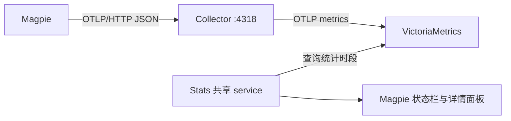

# Magpie 用量统计

Stats 消费 Magpie 导出的 OTLP 指标，在独立的 `magpie` widget 和详情面板中展示用量。
数据沿用已有监控链路：



`4318` 是接收写入的地址；Stats 使用下游 VictoriaMetrics 的查询 API。
Stats 不向 Collector 导出自己的遥测。

## 配置

Magpie 的可观测性设置需要同时开启 OTLP 导出和 metrics。

| 配置 | 默认值 | 用途 |
| --- | --- | --- |
| `magpie_enabled` | `true` | 开启消费 |
| `magpie_metrics_endpoint` | `http://localhost:8428` | VictoriaMetrics 查询基地址，可包含租户路径 |
| `magpie_service_name` | `magpie` | OTLP resource 的 `service.name` |
| `magpie_window` | `today` | 今天、7 天、30 天，也支持最近 1/6/24 小时 |
| `magpie_poll_seconds` | `10` | 查询间隔，范围 5–120 秒 |

当前监控中心位于 selfcloud 时，查询地址配置为 `http://selfcloud.lan:8428`。
后台每次刷新发送一个异步 GET 请求，最多一个在途请求。
面板打开时额外读取约 24 个时间桶；未完成的末尾时间桶独立查询，不从旧摘要中倒推。
图表查询串行发送，关闭面板后停止续租，后台不持续读取时间分布。

状态栏提供输入/输出 token 双行、图标加总量、mini 三种样式。详情面板按 Magpie
用量页组织：时段切换、Token/调用/耗时/失败摘要、Token 或调用时间分布，以及
提供商/模型排名。提供商下拉框支持“全部提供商”及当前时段内观察到的各个 provider；
切换后摘要、p95、模型排名、柱图和状态栏用量同步筛选。选项从未过滤的数据生成，
选择一个 provider 不会隐藏其他 provider 选项。切换使用已缓存的同一次观测，
不追加 HTTP 请求，也不刷新旧数据的时间戳；后续异步结果继续应用当前选择。
提供商选择器使用透明触发框和细边框，选项以面板同色列表展开，选中后收起。
它使用宿主可聚焦的容器与按钮，可通过键盘 Tab 和确认键操作，不依赖原生 select 的固定灰色填充。

选择调用视图时，排名与占比也按调用数切换。
面板为 380 × 480 px，超出内容滚动。模型名称和 provider 分开展示；同名模型在不同
provider 下独立聚合、排名并保留独立颜色。悬浮提示同时包含 provider 和模型名。
Provider 直接取 `gen_ai.provider.name`，缺失时显示未知，不根据模型命名空间推断。
若远端统一上报 `remote-magpie`，界面会如实显示该名称，无法仅靠这些指标还原远端内部 provider。

## 统计口径

实现依据 Magpie 的 `internal/otlp/otel_wire.go`：

- `gen_ai.client.operation.duration`：秒，包含模型调用的重试和失败尝试。
  请求父 span 不产生重复的 histogram 记录，因此界面使用“模型调用”。
- `gen_ai.client.token.usage`：按 `gen_ai.token.type` 区分 input/output。
  Input 已包含缓存读取和写入 token；output 已包含 reasoning token。
- 模型和提供商分别取 `gen_ai.request.model`、`gen_ai.provider.name`；
  `error.type` 非空的调用计入失败。

这些 histogram 使用 **delta temporality**，每个数据点仅包含当前导出批次。
VictoriaMetrics 保留 delta 点时，通过 `sum_over_time` 汇总所选窗口；不使用
`increase`，也不把重复轮询的结果再次累加。查询同时匹配原始与 Prometheus 风格的名称。
若 Collector 改成累计 temporality，需相应更换聚合方式，不能沿用 delta 查询。

今天以宿主本地时区的午夜为起点，7/30 天包含今天及之前 6/29 个自然日；
通过宿主格式化的日期寻找边界，处理夏令时变更。面板切换时段时忽略旧请求的迟到响应。
OTLP 本身也可能迟到，因此分布与摘要短暂不同步时保留真实查询结果，在后续刷新收敛。

平均耗时为总时长除以调用数；p95 由时段内聚合后的 histogram bucket 插值得出。
落入无穷大 bucket 时显示有限下界 `≥`。模型按 input + output token 排序，展示前八项。
仅有 duration/token 指标，未估算费用或从请求内容中提取数据。

## 无数据和故障

空查询结果表示此时段没有指标，显示 `—`；连接失败或快照过期显示不可用。
不以零替代缺失数据。存储返回 partial response 时不展示可能低估的结果。

Collector 的完整信号 URL 应配置到 `metrics_endpoint` / `traces_endpoint` /
`logs_endpoint`，避免通用 `endpoint` 自动追加路径，导致重复的 `/v1/metrics/v1/metrics`。
被旧链路丢弃的数据不会由这个查询界面补回；修复后需要新产生的 Magpie 调用。

诊断结果写入 `$XDG_RUNTIME_DIR/noctalia-stats/diagnostics.json` 的 `magpie` 字段：

```nu
noctalia msg plugin woxQAQ/stats:sampler all diagnose
noctalia msg plugin woxQAQ/stats:sampler all magpie-refresh
```

本地集成场景覆盖 delta 汇总、失败尝试、模型排名、p95、重复轮询、过期/空数据/
partial response，以及状态栏和面板完整生命周期。
